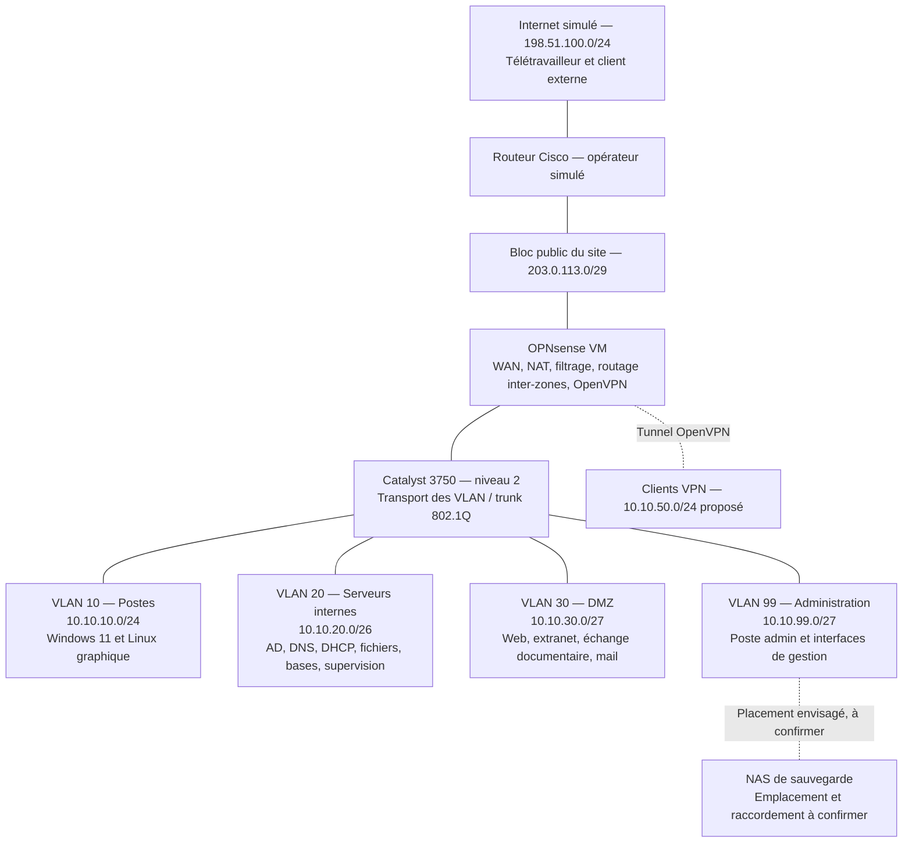

# Valdoré Services — SAE Cybersécurité 4A

Conception, déploiement et validation d'une maquette de système d'information sécurisé pour l'entreprise fictive **Valdoré Services**.

**Échéance finale : jeudi 14 janvier 2027 — rendu et démonstration physique.**  

| Information | Valeur |
|---|---|
| Équipe | Alexandre, Mendhy et Ethane |
| Dépôt | [LeSurvivant9/sae4a-valdore-services](https://github.com/LeSurvivant9/sae4a-valdore-services) |
| Phase actuelle | Conception — deux séances de brainstorming réalisées |
| Déploiement | Non commencé |
| Validation enseignante de l'architecture | À obtenir et à consigner |

## 1. Objectif et périmètre

Valdoré Services compte 82 salariés et souhaite disposer d'un système d'information hébergé dans ses locaux, cloisonné, administrable et exploitable.

La maquette doit démontrer :

- une identité centralisée et la configuration des postes ;
- des espaces de fichiers accessibles selon les droits des salariés ;
- la messagerie interne et externe simulée, avec webmail ;
- un site vitrine et un extranet clients avec base de données ;
- le dépôt et la récupération contrôlés de documents ;
- l'accès distant individuel par OpenVPN ;
- la navigation contrôlée et tracée ;
- la supervision, les alertes et les journaux ;
- les sauvegardes et la restauration de données, de comptes et d'un serveur ;
- le cloisonnement des zones et la restriction des accès d'administration.

Le réseau doit être dimensionné pour **au moins 120 équipements utilisateurs**. Un échantillon de postes suffit pour la maquette ; la conception doit également prendre en compte environ **35 télétravailleurs simultanés** et une croissance de **25 % sur trois ans**.

Les scénarios du §4.4 du sujet constituent la base de la recette. Les missions M1 à M10 précisent les travaux de justification, de mesure, d'exploitation et de restitution.

## 2. Équipe et fonctionnement

Les deux premières séances ont été consacrées à un **brainstorming collectif** : les trois membres ont contribué à l'analyse du sujet et aux décisions d'architecture. La répartition ci-dessous organise la suite.

| Membre | Pilotage principal | Vérification croisée |
|---|---|---|
| Alexandre | Réseau, adressage, Cisco, pare-feu et VPN | Services Linux, supervision et publication |
| Mendhy | Annuaire, postes, droits d'accès et sauvegardes | Réseau, filtrage et accès distant |
| Ethane | Services Linux, messagerie, web, bases et supervision | Identité, droits et restaurations |

La documentation, la sécurité, la recette et la soutenance sont des responsabilités communes.

Pour chaque ticket :

1. Identifier un pilote et un vérificateur différent.
2. Décrire un résultat observable et les exigences concernées.
3. Conserver la procédure et les preuves.
4. Faire vérifier le résultat avant de passer le ticket à « Validé ».

## 3. Ressources et contraintes

| Ressource / contrainte | Situation connue |
|---|---|
| Matériel | Réservé au trinôme |
| Mémoire | 32 Go de RAM |
| Processeur | Intel Xeon, environ 3,6 GHz ; modèle et nombre de cœurs à relever |
| Stockage | Environ 300 Go ; capacité réellement utilisable à confirmer |
| Réseau | Catalyst 3750 et routeur Cisco prévus par le sujet |
| Accès | Uniquement en salle, aucun accès distant hors séance |
| Fonctionnement nocturne | Les VM pourront rester en fonctionnement la nuit pour démontrer l'exécution planifiée des sauvegardes ; créneau et disponibilité de l'hôte/NAS à organiser |
| Persistance | Données conservées jusqu'à la fin des séances de janvier |
| NAS | Emplacement, capacité et modalités d'accès à confirmer |
| Virtualisation | Choix proposé : Proxmox VE ; disponibilité et autorisation à confirmer |

La maquette reste **isolée**. Tout raccordement au réseau de l'établissement ou à Internet nécessite la validation préalable de l'équipe enseignante. Les utilisateurs et données sont fictifs.

Le travail hors salle porte principalement sur la conception, la documentation, les scripts et la préparation des tests. Le matériel de l'école constitue l'environnement de validation commun.

## 4. Architecture proposée

> Cette section décrit une cible de conception, pas une infrastructure déjà déployée. Les préférences logicielles restent à étayer par les matrices de choix de M3.

### Principes

- OPNsense assure le routage inter-zones, le filtrage restrictif, la translation d'adresses et OpenVPN.
- Le Catalyst 3750 fonctionne en niveau 2 et transporte les VLAN.
- Les services exposés et internes sont hébergés sur des machines distinctes.
- L'administration utilise une zone dédiée et des comptes nominatifs séparés des comptes courants.
- Les clients VPN utilisent un sous-réseau distinct ; le mécanisme d'application des droits par profil reste à préciser.
- Certains services sont regroupés pour respecter les ressources disponibles ; les conséquences sur la sécurité et la disponibilité doivent être documentées.

### Schéma logique



Ce schéma représente les relations logiques. Le câblage physique, les interfaces de l'hyperviseur et les réseaux virtuels restent à documenter. Les liaisons ne représentent pas des autorisations de circulation sans restriction.

### Plan de réseaux

| Zone | Réseau | Capacité d'adressage / usage |
|---|---|---|
| Internet simulé | `198.51.100.0/24` | Postes externes et services externes simulés |
| Bloc public du site | `203.0.113.0/29` | 6 adresses hôtes ; interconnexion opérateur / WAN |
| VLAN 10 — Postes | `10.10.10.0/24` | 254 adresses hôtes ; couvre les 120 équipements demandés |
| VLAN 20 — Serveurs internes | `10.10.20.0/26` | 62 adresses hôtes |
| VLAN 30 — DMZ | `10.10.30.0/27` | 30 adresses hôtes |
| VLAN 99 — Administration | `10.10.99.0/27` | 30 adresses hôtes |
| Clients VPN | `10.10.50.0/24` proposé | Sous-réseau distinct ; attribution et règles à définir |

Les adresses des machines, passerelles, plages DHCP, interfaces physiques et le nom du domaine interne restent à fixer.

### Composants envisagés

| Composant | Zone | Rôle / logiciels envisagés |
|---|---|---|
| Routeur Cisco | Externe | Routage de l'Internet simulé et du bloc public |
| Catalyst 3750 | Infrastructure | VLAN, ports d'accès, trunks et administration chiffrée |
| OPNsense | Frontière des zones | Pare-feu, NAT, routage et OpenVPN |
| Windows Server | VLAN 20 | Active Directory, DNS, DHCP et stratégies de groupe |
| Debian interne | VLAN 20 | Samba, PostgreSQL, Zabbix et rsyslog |
| Debian DMZ | VLAN 30 | Nginx, Postfix, Dovecot, Roundcube et Nextcloud |
| NAS | À confirmer | Stockage et protection des sauvegardes |
| Windows 11 | VLAN 10 | Poste salarié intégré au domaine |
| Linux graphique | VLAN 10 | Poste salarié accédant aux ressources |
| Poste externe | Internet simulé | Tests client et télétravail |
| Poste d'administration | VLAN 99 | Gestion des équipements et serveurs |

Le contrôle de navigation, son logiciel et son emplacement doivent être vérifiés pour les versions retenues. La proposition initiale évoque Squid ; son intégration n'est pas considérée comme acquise.

Le poste externe peut être utilisé successivement pour les deux rôles, avec VPN déconnecté lors des tests d'accès public. Le correspondant mail externe et la résolution publique simulée nécessitent encore une conception détaillée.

### Dimensionnement initial à vérifier

| Machine | RAM de départ proposée |
|---|---:|
| OPNsense | 2 Go |
| Windows Server | 4 Go |
| Debian interne | 4 Go |
| Debian DMZ | 5 Go |
| Windows 11 | 4 Go |
| Linux graphique salarié | 2 Go |
| Linux graphique externe | 2 Go |
| **Total hors NAS** | **23 Go** |

Ces allocations sont des estimations de travail, à ajuster par mesure. Environ 9 Go restent disponibles pour l'hôte, les marges et un éventuel NAS virtuel. Les allocations CPU et disque restent à établir, notamment après clarification du NAS.

### Sécurité et limites de conception

- Seuls les services publics nécessaires seront publiés vers la DMZ.
- Les postes ne devront joindre ni directement les bases ni les interfaces d'administration.
- Les droits sur les fichiers suivront l'intégralité du §3.2, y compris les droits par projet.
- Les flux de sauvegarde, supervision, journaux, DNS et synchronisation horaire seront explicitement définis.
- La restriction des interfaces d'administration ne doit pas être confondue avec l'interdiction de tout flux technique vers la zone hébergeant les sauvegardes.
- Le regroupement fichiers / bases / supervision crée un domaine de panne commun et nécessite des restrictions locales : le pare-feu inter-VLAN ne sépare pas les services d'une même machine.
- Un NAS virtuel sur le même stockage que les sources ne protège pas contre la perte du disque physique.
- La protection contre l'effacement des sauvegardes doit être configurée et testée ; un snapshot n'est pas présumé immuable.
- La collecte rsyslog sur le serveur interne partagé contribue à Q7, mais ne satisfait pas telle quelle Q9, qui demande un serveur dédié.
- La double authentification VPN Q10 reste un objectif souhaitable après validation du fonctionnement de base.

## 5. Avancement du backlog

Les numéros ci-dessous sont des identifiants de travail, pas nécessairement les numéros des issues GitHub.

| Ticket | Sujet | État | Pilote |
|---|---|---|---|
| 01 | Confirmer les contraintes matérielles et pédagogiques | En cours | Alexandre |
| 02 | Organiser le dépôt et le suivi | En cours | Mendhy |
| 03 | Comparer cinq solutions structurantes | En cours | Ethane |
| 04 | Constituer le dossier documentaire | À faire — références à rassembler | Ethane |
| 05 | Finaliser l'architecture et le dimensionnement | En cours | Alexandre |
| 06 | Définir les droits, les flux et le plan de déploiement | En cours | Mendhy |
| 07–11 | Virtualisation, Cisco, pare-feu, annuaire et postes | À faire | À répartir par ticket |
| 12–18 | Services, télétravail, supervision et sauvegardes | À faire | À répartir par ticket |
| 19–22 | Mesures, audit, exploitation et recette | À faire | Collectif |
| 23–24 | Formation, passation, rapport et démonstration | À faire | Collectif |

### Sous-tâches de conception déjà réalisées

- [x] Identifier les quatre zones et proposer leurs sous-réseaux.
- [x] Définir les rôles du routeur, du pare-feu et du switch.
- [x] Identifier les machines et services envisagés.
- [x] Décrire les regroupements et leurs principales limites.
- [x] Identifier les arbitrages restant à obtenir.
- [ ] Compléter l'adressage machine par machine.
- [ ] Produire le schéma physique.
- [ ] Finaliser le budget CPU, mémoire et stockage.
- [ ] Produire les cinq matrices de choix pondérées.
- [ ] Détailler la matrice des droits et celle des flux.
- [ ] Consigner la revue de conception avec les enseignants.

### Lecture des statuts

- **Non commencée / À faire** : mise en œuvre non engagée.
- **En cours** : conception ou réalisation engagée.
- **Réalisée / À vérifier** : travail terminé, vérification restante.
- **Validée** : critères vérifiés et preuve identifiable disponible.

R1, T1 et T2 sont actuellement **en cours**. La description d'un service dans l'architecture ne valide pas son déploiement. Aucun résultat technique de recette n'est encore revendiqué.

## 6. Journal des séances

### Séances 1 et 2 — Cadrage et conception collective

**Dates : à compléter.**  
**Participants : Alexandre, Mendhy et Ethane.**

Ce compte rendu est une synthèse rétrospective des deux séances. Les contributions au brainstorming sont collectives et partagées entre les trois membres ; aucune configuration individuelle n'est revendiquée.

**Travail réalisé**

- Lecture et analyse des besoins et contraintes du sujet.
- Élaboration d'une première proposition de solution en deux pages.
- Définition des quatre zones et du plan de sous-réseaux.
- Choix de conception : routage inter-zones centralisé sur le pare-feu et Catalyst en niveau 2.
- Identification des services et des machines envisagés.
- Proposition de regroupement des services internes et exposés sur deux serveurs Linux distincts.
- Rédaction d'une description textuelle de l'architecture.
- Identification des questions à soumettre aux enseignants.

**Productions**

- Premier jet : `annex/Valdore_Services_Solution_2_pages.pdf` — document local non versionné.
- Description textuelle « Architecture Logique et Réseau — Valdoré Services », synthétisée dans ce README.

**Décisions de conception du groupe**

| Décision | Motivation | Situation |
|---|---|---|
| Quatre zones de confiance | Cloisonner postes, services internes, services exposés et administration | Retenue pour la proposition |
| Routage sur OPNsense | Centraliser le filtrage inter-zones | Retenu pour la proposition |
| Catalyst en niveau 2 | Transporter les VLAN sans déplacer le routage hors du pare-feu | Retenu pour la proposition |
| Séparation interne / DMZ par VM | Éviter d'héberger les services publics avec les services internes | Retenue pour la proposition |
| Regroupement de certains services | Limiter les ressources consommées | À faire valider |
| Nextcloud pour l'extranet et les documents | Mutualiser les fonctions clients | Adéquation au besoin à faire valider |

**Difficultés et incertitudes**

- Équipe débutante en administration systèmes et réseaux.
- Accès au matériel limité aux séances en salle.
- Hyperviseur, câblage et NAS non confirmés.
- Dimensionnement détaillé et comparaisons logicielles à finaliser.

**État à l'issue de ces travaux**

- Aucun déploiement réalisé.
- Aucun scénario de recette exécuté.
- Aucune validation enseignante de l'architecture encore consignée.

**Prochaines étapes**

1. Obtenir les réponses aux questions bloquantes.
2. Compléter les comparaisons et les références documentaires.
3. Finaliser l'inventaire, le raccordement et l'adressage.
4. Définir les droits, les flux et les points de contrôle du déploiement.
5. Préparer le cahier de recette.
6. Commencer la virtualisation et le socle réseau en salle.

## 7. Questions et arbitrages enseignants

| Sujet | Question | État |
|---|---|---|
| Calendrier final | Date du rendu et de la démonstration ? | 16 janvier 2027, information communiquée par l'équipe |
| Séance d'incidents | À quelle séance seront provoqués les incidents de M5 ? | À confirmer |
| Virtualisation | Quel hyperviseur est disponible ou autorisé ? | À confirmer |
| Raccordement | Quelles interfaces, quels ports et quel câblage sont disponibles ? | À confirmer |
| NAS | Équipement externe ou VM ? Capacité, accès et disponibilité ? | À confirmer |
| Sauvegardes nocturnes | Les VM peuvent fonctionner la nuit pour prouver l'exécution des scripts | Possibilité confirmée par l'équipe ; organiser le créneau et vérifier la disponibilité de l'hôte et du NAS |
| Téléchargements | Comment obtenir les ISO, paquets, mises à jour et données d'audit ? | À confirmer |
| Regroupements | Les regroupements interne et DMZ sont-ils acceptés ? | À confirmer |
| Extranet | L'usage prévu de Nextcloud satisfait-il V4 et V5 ? | À confirmer |
| Comptabilité | Quelle représentation applicative minimale est attendue ? | À confirmer |
| Linux | Quel scénario d'ouverture de session est attendu compte tenu de S3/S4 ? | À confirmer |
| Évaluation | Grille individuelle et modalités de démonstration disponibles ? | À confirmer |

Chaque réponse devra être complétée par sa date, son interlocuteur et les conséquences sur la conception.

## 8. Recette prévue

| Nº | Scénario du §4.4 | État |
|---|---|---|
| 1 | Créer un utilisateur, ouvrir les sessions Windows/Linux et vérifier ses droits | À tester |
| 2 | Obtenir automatiquement la configuration réseau et résoudre les noms internes/publics | À tester |
| 3 | Autoriser les RH à leurs dossiers et refuser l'accès à un consultant | À tester |
| 4 | Échanger des courriels internes et externes simulés ; consulter le webmail | À tester |
| 5 | Accéder à la vitrine, s'authentifier à l'extranet et déposer un document depuis l'extérieur | À tester |
| 6 | Accéder aux dossiers et à la messagerie par VPN, sans accès aux outils d'administration | À tester |
| 7 | Refuser depuis un poste utilisateur les accès directs aux bases et aux interfaces d'administration | À tester |
| 8 | Naviguer sur l'Internet simulé et retrouver les traces | À tester |
| 9 | Arrêter volontairement un service et constater une alerte | À tester |
| 10 | Supprimer puis restaurer un dossier et restaurer un compte de l'annuaire | À tester |

Chaque scénario sera détaillé avec prérequis, étapes, résultat attendu, résultat obtenu, auteur, vérificateur et preuve.

Travaux complémentaires à prévoir :

- au moins deux tests de charge et une comparaison avant/après optimisation ;
- collecte d'une dizaine de métriques pendant au moins une séance ;
- analyse d'une capture réseau ;
- audit, corrections et vérification des corrections ;
- restauration intégrale d'un serveur, chronométrée ;
- procédures d'exploitation, formation et passation ;
- synthèse anglaise et intervention orale en anglais.

## 9. Routine de fin de séance

- [ ] Noter la date, les participants et les contributions.
- [ ] Actualiser les tickets et l'état des exigences.
- [ ] Enregistrer les procédures, preuves et configurations expurgées des secrets.
- [ ] Consigner les incidents, difficultés et décisions.
- [ ] En séance encadrée : réaliser le point client de 5 minutes et noter les retours.
- [ ] Sauvegarder les configurations avant intervention et conserver les versions utiles.
- [ ] Vérifier la persistance du travail avant l'extinction.
- [ ] Définir les objectifs de la séance suivante.

## 10. Utilisation du dépôt

Clonage par SSH :

```bash
git clone git@github.com:LeSurvivant9/sae4a-valdore-services.git
```

Le dossier **`annex/` est conservé uniquement en local et exclu du suivi Git**. Il contient notamment le sujet et le premier jet PDF ; ces fichiers ne seront pas présents lors d'un clonage du dépôt.

Les fichiers macOS, exports locaux de conversations, images d'installation, disques de VM et certains formats de secrets sont également ignorés.

Avant chaque commit, vérifier les fichiers sélectionnés. Le `.gitignore` ne remplace pas la vérification des exports de configuration : ils peuvent contenir des mots de passe, certificats privés ou jetons.
